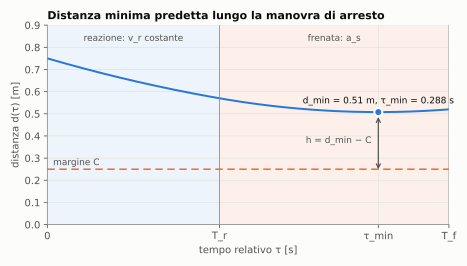
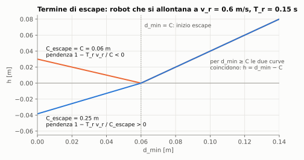
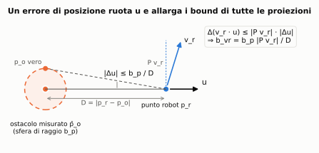
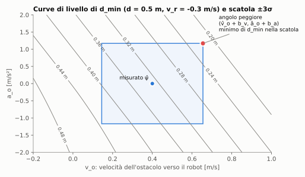
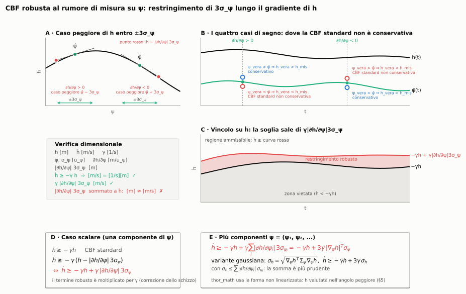
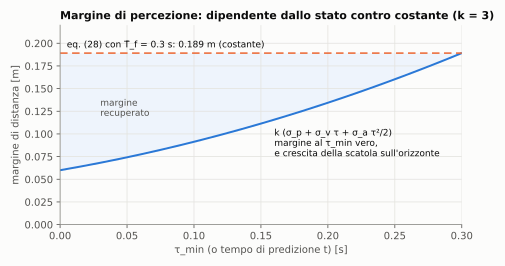

# CBF predittiva per SSM, robusta all'incertezza di percezione

Questo documento descrive in modo completo il metodo implementato in
`thor_math` (kernel in [cbf.h](../include/thor_math/cbf.h), uso nel QP in
[thor_math.cpp](../src/thor_math/thor_math.cpp)) ed esposto in
`thor_controllers`. Copre:

- il modello di distanza minima predetta;
- la barriera e il suo termine di escape;
- la condizione CBF nel QP;
- la robustezza all'incertezza sullo stato dell'ostacolo: ipotesi, risultati,
  dimostrazioni e limiti.

Documenti collegati:

- [api.md](api.md): riferimento dell'API;
- [worst_case_h_design.md](worst_case_h_design.md): storia delle scelte di
  design e discussione dei punti aperti;
- [robust_margin_deadlock.md](robust_margin_deadlock.md): il deadlock della
  forma linearizzata.

Le figure si rigenerano con `python3 docs/figures/make_figures.py`.

---

## Indice

1. [Notazione e convenzioni](#1-notazione-e-convenzioni)
2. [Distanza minima predetta](#2-distanza-minima-predetta)
3. [Barriera e termine di escape](#3-barriera-e-termine-di-escape)
4. [Condizione CBF nel QP](#4-condizione-cbf-nel-qp)
5. [Robustezza all'incertezza di percezione](#5-robustezza-allincertezza-di-percezione)
6. [Scelta di C e dei σ](#6-scelta-di-c-e-dei-σ)
7. [Parametri](#7-parametri)
8. [Ipotesi e limiti](#8-ipotesi-e-limiti)
9. [Verifica](#9-verifica)
10. [Note sull'articolo](#10-note-sullarticolo)

---

## 1. Notazione e convenzioni

Per ogni coppia (sfera del robot `j`, ostacolo `k`):

| Simbolo | Significato | Unità |
|---|---|---|
| `p_r, v_r, a_r` | centro della sfera del robot, velocità, accelerazione | m, m/s, m/s² |
| `p_o, v_o, a_o` | centro dell'ostacolo (o punto più vicino dell'asse di una capsula), velocità, accelerazione | m, m/s, m/s² |
| `D = ‖p_r − p_o‖` | distanza tra i centri | m |
| `u = (p_r − p_o)/D` | direzione dall'ostacolo al robot | – |
| `P = I − u uᵀ` | proiettore sul piano normale a `u` | – |
| `ρ` | somma dei raggi, più `δ_H` | m |
| `d = D − ρ` | distanza tra le superfici | m |
| `v_r∥ = u·v_r` | velocità del robot lungo `u` (negativa: si avvicina) | m/s |
| `v_o∥ = u·v_o` | velocità dell'ostacolo lungo `u` (positiva: si avvicina) | m/s |
| `a_o∥ = u·a_o` | accelerazione dell'ostacolo lungo `u` | m/s² |
| `ψ = [d, v_r∥, v_o∥, a_o∥]` | stato mappato, eq. (13) | – |
| `T_r` | tempo di reazione | s |
| `a_s` | decelerazione di frenata del robot (> 0) | m/s² |
| `C` | margine di sicurezza tra le superfici | m |
| `C_e` | scala del termine di escape (`C_escape`, 0 → `C`) | m |
| `γ` | guadagno della funzione di classe K | 1/s |
| `σ_p, σ_v, σ_a` | deviazioni standard di posizione, velocità e accelerazione dell'ostacolo | m, m/s, m/s² |
| `k` | numero di deviazioni standard (`sigma_bound`) | – |

Convenzione di segno (Tab. I dell'articolo): `ḋ = v_r∥ − v_o∥`, negativa
quando la coppia si avvicina. Nel codice `v_h∥` e `a_h` dell'articolo si
chiamano `v_o` e `a_o`, perché l'ostacolo non è necessariamente una persona.

---

## 2. Distanza minima predetta

### 2.1 Modello di arresto

Se all'istante attuale si comandasse un arresto, si assume che:

- il robot mantenga `v_r∥` per il tempo di reazione `T_r`;
- poi freni con decelerazione `a_s` fino a fermarsi;
- l'ostacolo mantenga l'accelerazione `a_o∥`.

Lungo `u` la distanza vale

```
d(τ) = d + (v_r∥ − v_o∥) τ − a_o∥ τ²/2                         0 ≤ τ ≤ T_r
d(τ) = d + (v_r∥ − v_o∥) τ − a_o∥ τ²/2 + a_s (τ − T_r)²/2       T_r < τ ≤ T_f
```

La finestra termina in

```
T_f = T_r − v_r∥ / a_s     se v_r∥ < 0  (il robot si ferma)
T_f = T_r                  se v_r∥ ≥ 0  (il robot non deve frenare)
```

e

```
d_min(ψ) = min_{τ ∈ [0, T_f]} d(τ),      h = d_min − C   (fuori dal margine)
```



*Figura 1. Distanza predetta durante la reazione e la frenata, per un robot
e una persona che si avvicinano mentre la persona decelera. Il minimo è il
punto stazionario nella fase di frenata.*

### 2.2 Candidati del minimo

`d(τ)` è un polinomio di secondo grado in ciascuna fase, quindi il minimo è
agli estremi o in un punto stazionario interno (teoremi di Weierstrass e di
Fermat). I candidati sono:

| Candidato | Valore | Quando |
|---|---|---|
| `0` | – | sempre |
| `T_r` | – | `v_r∥ ≥ 0` |
| `T_f` | `T_r − v_r∥/a_s` | `v_r∥ < 0` |
| `τ₁` | `(v_r∥ − v_o∥) / a_o∥` | `a_o∥ ≠ 0`, `τ₁ ∈ (0, T_r)` |
| `τ₂` | `(v_r∥ − v_o∥ − a_s T_r) / (a_o∥ − a_s)` | `v_r∥ < 0`, `a_o∥ ≠ a_s`, `τ₂ ∈ (T_r, T_f)` |

`cbf::minimumDistance()` valuta tutti i candidati validi e prende il minimo,
in tempo costante.

### 2.3 Gradiente di `d_min`

Per il teorema dell'inviluppo, la derivata di `d_min` rispetto a un parametro
è la derivata parziale di `d(τ)` valutata in `τ_min`:

```
∂d_min/∂d     = 1
∂d_min/∂v_r∥  = τ_min − [τ_min = T_f] · ḋ(T_f) / a_s
∂d_min/∂v_o∥  = −τ_min
∂d_min/∂a_o∥  = −τ_min² / 2
```

Il termine tra parentesi quadre compare solo quando il minimo è
all'estremo mobile `T_f`, che dipende da `v_r∥`.

---

## 3. Barriera e termine di escape

### 3.1 Definizione

```
h(ψ) = d_min − C                                              se d_min ≥ C
h(ψ) = d_min − C + (C − d_min) / C_e · T_r · v_r∥              se d_min < C
```

Il safe set è `h ≥ 0`. Dentro il margine (`d_min < C`) il termine di escape
dà a un robot che si allontana (`v_r∥ > 0`) un `h` più alto, e quindi
autorità di controllo: `∂h/∂v_r∥` contiene `(C − d_min) T_r / C_e > 0`. Senza
questo termine, un robot fermo con `d_min = d` avrebbe `∂h/∂v_r∥ = 0`, cioè
`L_g h = 0`: non potrebbe agire sulla barriera.

### 3.2 Proprietà

- **Continuità.** Il termine si annulla in `d_min = C`, quindi `h` è continua.
  Il bordo del safe set `h = 0` coincide con `d_min = C` e l'escape è attivo
  proprio lì. È questa la proprietà che evita il deadlock
  ([robust_margin_deadlock.md](robust_margin_deadlock.md)).
- **Pendenza in `d_min`.** Dentro il margine

  ```
  ∂h/∂d_min = 1 − T_r v_r∥ / C_e
  ```

  che è negativa per `v_r∥ > C_e / T_r`. In quel regime una `d_min` più
  piccola dà una `h` più grande: è un artefatto del termine di escape.
- **Ruolo di `C_e`.** `C_e` cambia solo la pendenza, non il punto di
  attivazione. Con `C_e = C` (il default) la soglia è `C / T_r`: 1.67 m/s con
  `C = 0.25 m`, ma 0.4 m/s con `C = 0.06 m`. Separare `C_e` da `C` permette di
  ridurre il margine senza portare la soglia alle velocità tipiche.



*Figura 2. Barriera per un robot che si allontana a 0.6 m/s con `C = 0.06 m`.
Con `C_e = C` la pendenza dentro il margine è negativa; con `C_e = 0.25 m` è
positiva. Fuori dal margine le due curve coincidono.*

---

## 4. Condizione CBF nel QP

### 4.1 Derivate di Lie

Con l'accelerazione del punto del robot `a_r` come ingresso,
`ḣ = L_f h + L_g h · a_r`, dove

```
L_f h = ∇_ψ h · ψ̇_f,        L_g h = (∂h/∂v_r∥) u
```

e `ψ̇_f` è la derivata di ψ con `a_r = 0`. Poiché `u` ruota,
`u̇ = P (v_r − v_o) / D`, si ha:

```
ψ̇_f,0 = u · (v_r − v_o)                                  (= ḋ)
ψ̇_f,1 = (P v_r / D) · (v_r − v_o)
ψ̇_f,2 = (P v_o / D) · (v_r − v_o) + a_o∥
ψ̇_f,3 = (P a_o / D) · (v_r − v_o)                        (jerk dell'ostacolo nullo)
```

I termini con `P(·)/D` sono i **termini di rotazione**. Il gradiente rispetto
alla posizione del robot, usato dalla formulazione discreta, è

```
∂h/∂p_r = (∂h/∂d) u + Σ_{i=1..3} (∂h/∂ψ_i) P w_i / D,   w = (v_r, v_o, a_o)
```

L'accelerazione articolare `ü` entra tramite `a_r = J ü + J̇ q̇`.

### 4.2 Due formulazioni

- **Continua** (`CbfFormulation::continuous`), eq. (16) dell'articolo, imposta
  all'inizio di ogni intervallo `i`:

  ```
  L_g h (J u_i + J̇ q̇) + L_f h + γ h ≥ 0
  ```

- **Discreta** (`CbfFormulation::discrete`, default), linearizzata attorno alla
  soluzione precedente:

  ```
  h(X_{i+1}) ≥ max(0, 1 − γ Δt_i) h(X_i)
  ```

I dettagli (linearizzazione, ri-linearizzazioni, costo) sono in
[api.md §2.6](api.md#26-control-barrier-function).

---

## 5. Robustezza all'incertezza di percezione

### 5.1 Ipotesi

- **(A1) Errore limitato.** Lo stato vero dell'ostacolo dista da quello
  misurato al più `b_p`, `b_v`, `b_a` in norma euclidea su posizione,
  velocità e accelerazione: `‖p_o − p̂_o‖ ≤ b_p`, e così via. Con errori
  gaussiani isotropi, `b = k σ` copre la probabilità corrispondente a `k`
  deviazioni standard per componente.
- **(A2) Robot esatto.** Posizione e velocità del robot sono note (encoder e
  cinematica).
- **(A3) Errori lentamente variabili.** Nell'intervallo di controllo l'errore
  di misura è costante.
- **(A4) Modello dell'ostacolo.** Accelerazione costante sull'orizzonte di
  arresto; l'errore di questo modello (jerk) non è un errore di misura e va
  in `C` (§6).

### 5.2 Dai bound sullo stato ai bound su ψ

**Lemma 1.** Sotto (A1)–(A2), al primo ordine in `b_p / D`, lo stato mappato
vero `ψ` soddisfa `|ψ_i − ψ̂_i| ≤ b_i`, con

```
b_d   = b_p
b_vr  = b_p ‖P v_r‖ / D
b_vo  = b_v + b_p ‖P v_o‖ / D
b_ao  = b_a + b_p ‖P a_o‖ / D
```

*Dimostrazione.* `D` è 1-Lipschitz nella posizione, quindi `|ΔD| ≤ b_p`. La
direzione `u = (p_r − p_o)/D` ha jacobiano `−P/D` rispetto a `p_o`, quindi
`‖Δu‖ ≤ b_p / D` al primo ordine. Per una proiezione `w·u`,

```
Δ(w·u) = Δw·u + w·Δu,     |w·Δu| = |(P w)·Δu| ≤ ‖P w‖ b_p / D
```

perché `Δu` è ortogonale a `u` al primo ordine. Con `Δw = 0` per il robot
(A2) e `‖Δw‖ ≤ b_v` o `b_a` per l'ostacolo si ottengono i quattro bound. ∎

I bound sono **somme**, non radici di somme di quadrati: descrivono una
scatola di caso peggiore, non una covarianza.



*Figura 3. Un errore di posizione dell'ostacolo ruota `u` di al più `b_p/D`.
La proiezione di una velocità cambia in proporzione alla sua componente
normale: anche `v_r∥` è incerta, pur con il robot misurato esattamente.*

### 5.3 Monotonia di `d_min`

**Lemma 2.** `d_min(ψ)` è non decrescente in `d` e in `v_r∥`, e non crescente
in `v_o∥` e in `a_o∥`.

*Dimostrazione.* Per ogni `τ` fissato:

- `∂d(τ)/∂d = 1 ≥ 0`;
- `∂d(τ)/∂v_o∥ = −τ ≤ 0`;
- `∂d(τ)/∂a_o∥ = −τ²/2 ≤ 0`.

Il minimo di una famiglia di funzioni non decrescenti (o non crescenti) in un
parametro lo è anche lui, perché `min_τ f(τ, x)` conserva l'ordinamento
puntuale. Questo chiude i casi `d`, `v_o∥` e `a_o∥`, dove la finestra
`[0, T_f]` non dipende dal parametro.

Per `v_r∥` la finestra dipende dal parametro. Siano `v' ≥ v` e
`T_f' = T_f(v') ≤ T_f(v)`: `T_f` è non crescente in `v_r∥` e vale `T_r` per
`v_r∥ ≥ 0`. Per ogni `τ ∈ [0, T_f']` entrambe le espressioni di `d(τ)` del
§2.1 hanno `∂d(τ)/∂v_r∥ = τ ≥ 0`, quindi `d(τ; v') ≥ d(τ; v)`. Allora

```
d_min(v') = min_{[0, T_f']} d(τ; v') ≥ min_{[0, T_f']} d(τ; v) ≥ min_{[0, T_f(v)]} d(τ; v) = d_min(v)
```

dove l'ultima disuguaglianza vale perché `[0, T_f'] ⊆ [0, T_f(v)]`. ∎

### 5.4 L'angolo peggiore

**Proposizione 1.** Sia `B = {ψ : |ψ_i − ψ̂_i| ≤ b_i}` la scatola del Lemma 1 e

```
ψ_w = (d̂ − b_d,  v̂_r∥ − b_vr,  v̂_o∥ + b_vo,  â_o∥ + b_ao)
```

Allora:

1. `d_min(ψ_w) = min_{ψ ∈ B} d_min(ψ)`;
2. se `v_r∥ ≤ C_e / T_r` in tutta `B`, anche `h(ψ_w) = min_{ψ ∈ B} h(ψ)`.

*Dimostrazione.* (1) segue dal Lemma 2 componente per componente. Per (2):
fuori dal margine `h = d_min − C` è crescente in `d_min`. Dentro il margine
`h = d_min (1 − T_r v_r∥/C_e) + C T_r v_r∥/C_e − C`: con
`1 − T_r v_r∥/C_e ≥ 0` è non decrescente in `d_min`, e la sua derivata in
`v_r∥` a `d_min` fisso, `(C − d_min) T_r / C_e`, è non negativa. Quindi `h` è
non decrescente in `d_min` e in `v_r∥`, e per il Lemma 2 è minimizzata nello
stesso angolo. ∎

**Corollario (sicurezza).** Se `h(ψ_w) ≥ 0`, allora `h(ψ) ≥ 0` per ogni stato
vero compatibile con le misure: la condizione di sicurezza vale per lo stato
vero, entro l'approssimazione del primo ordine del Lemma 1.

Il caso escluso dalla (2) è un robot che si allontana a più di `C_e/T_r`
dentro il margine. Lì l'angolo resta il minimo di `d_min` ma non di `h`,
perché il termine di escape premia una `d_min` più piccola. È un caso
favorevole (il robot sta già scappando) e `C_e` serve a spostarlo fuori dalle
velocità di lavoro.



*Figura 4. Curve di livello di `d_min` nel piano `(v_o∥, a_o∥)`, con `d` e
`v_r∥` fissati. La scatola di ±3σ attorno alla misura ha il minimo di `d_min`
nell'angolo in alto a destra, come previsto dal Lemma 2.*

**Calcolo nel 3D.** `cbf::barrierTerms()` non lavora su ψ ma sullo stato 3D.
Per ottenere l'angolo:

- sposta le velocità lungo `u`: `v_r − b_vr u`, `v_o + b_vo u`, `a_o + b_ao u`;
- aggiunge `b_d` al raggio.

Gli spostamenti lungo `u` cambiano le proiezioni esattamente di `b_i` e
lasciano invariati `u`, `D` e le componenti normali. Così `h`, `L_f h`,
`L_g h` e `∂h/∂p_r` sono esattamente quelli dello stato all'angolo, calcolati
con le formule del §4.1.

### 5.5 Barriera robusta e condizione CBF

La barriera usata nel QP è

```
h_rob(ψ̂) = h(ψ_w(ψ̂))
```

e la condizione è quella standard, con tutti i termini calcolati nell'angolo:

```
L_f h(ψ_w) + L_g h(ψ_w) · a_r + γ h(ψ_w) ≥ 0          (continua)
h_rob(X_{i+1}) ≥ max(0, 1 − γ Δt_i) h_rob(X_i)        (discreta)
```

Questa forma, a differenza della linearizzazione
`ḣ + γ(h − Σ|∂h/∂ψ_i| b_i) ≥ 0`:

- **è dimensionalmente coerente:** il termine robusto è dentro `h` e viene
  moltiplicato per `γ` come il resto (in m/s);
- **non è linearizzata in ψ:** è esatta per il Lemma 2;
- **non crea deadlock:** il bordo `h_rob = 0` è `d_min(ψ_w) = C`, dove il
  termine di escape è attivo. La forma linearizzata sposta il bordo dove
  `d_min ≥ C`, e lì un robot fermo ha `L_g h = 0`.

La Figura 5 riprende lo schizzo da cui è partita l'idea. Rispetto allo schizzo
originale, nei pannelli C, D ed E il termine robusto è moltiplicato per `γ`.



*Figura 5. (A) Caso peggiore di `h` entro ±3σ secondo il segno della
pendenza. (B) Quando la CBF standard non è conservativa. (C) La soglia su
`ḣ` sale di `γ|∂h/∂ψ|3σ`. (D, E) Formule nel caso scalare e vettoriale.
`thor_math` usa la versione non linearizzata, cioè l'angolo della
Proposizione 1.*

### 5.6 Robustezza della derivata

**Proposizione 2.** Sotto (A1)–(A3), lungo il moto vero

```
d/dt h_rob ≥ L_f h(ψ_w) + L_g h(ψ_w) · a_r − β
```

al primo ordine nei bound, con

```
β = |Σ_{i=1..3} (∂h/∂ψ_i) r_i| / D · b_d
  + 2 max(0, −∂h/∂d) (b_vr + b_vo)
  + 2 max(0, ∂h/∂v_o∥) b_ao
```

dove `r_i = ψ̇_f,i − [i = 2] a_o∥` sono i termini di rotazione del §4.1, e
tutte le derivate sono valutate in `ψ_w`.

*Dimostrazione.* Per (A3) i bound sono costanti nell'intervallo, quindi
`h_rob(ψ̂(t)) = h(ψ̂(t) − s⊙b)` e

```
d/dt h_rob = ∇_ψ h(ψ_w) · ψ̇̂ = ∇_ψ h(ψ_w) · ψ̇(stato vero)
```

Il gradiente è fisso nell'angolo: non compaiono derivate seconde di `h`.
`L_f h + L_g h · a_r` usa invece `ψ̇(ψ_w)`. L'errore è

```
E = ∇_ψ h(ψ_w) · (ψ̇(vero) − ψ̇(ψ_w))
```

e si scompone così:

- **Ingresso.** `a_r` entra solo in `ψ̇_1` come `u·a_r`, e `u` è lo stesso, quindi
  la parte di controllo non contribuisce.
- **`ψ̇_0 = v_r∥ − v_o∥` e `ψ̇_2 ⊃ a_o∥`.** Dall'angolo, i valori veri
  differiscono di `v_r∥ − v_r∥,w ∈ [0, 2 b_vr]`, `v_o∥ − v_o∥,w ∈ [−2 b_vo, 0]`,
  `a_o∥ − a_o∥,w ∈ [−2 b_ao, 0]`. Il contributo a `E` è
  `(∂h/∂d)(Δv_r∥ − Δv_o∥) + (∂h/∂v_o∥) Δa_o∥`. Il suo minimo è
  `−2 max(0, −∂h/∂d)(b_vr + b_vo) − 2 max(0, ∂h/∂v_o∥) b_ao`.
- **Termini di rotazione.** Scalano con `1/D`; con `|ΔD| ≤ b_d` cambiano di
  `−r_i ΔD / D` al primo ordine. Il caso peggiore è
  `|Σ (∂h/∂ψ_i) r_i| b_d / D`. ∎

**Conseguenze:**

- Quando `∂h/∂d ≥ 0` e `∂h/∂v_o∥ ≤ 0`, cioè sempre tranne che nel regime di
  escape a pendenza negativa, velocità e accelerazione **non contribuiscono**:
  l'angolo è pessimista anche per `ḣ`. Resta solo il termine di rotazione,
  piccolo lontano dall'ostacolo.
- `β` non dipende da `a_r`: non serve l'accelerazione della soluzione
  precedente.
- `β` è un tasso [m/s]: nella condizione continua si sottrae **senza** `γ`
  (`BarrierTerms::rate_bound`, attivato da `cbf_robust_rate`).
- La formulazione discreta vincola `h_rob` direttamente a ogni nodo e non ne
  ha bisogno.

### 5.7 Propagazione lungo l'orizzonte

Nei nodi futuri l'ostacolo è estrapolato ad accelerazione costante fino al
tempo `t`. Gli errori si propagano e, in caso peggiore, si sommano:

```
b_p(t) = k (σ_p + σ_v t + σ_a t²/2)
b_v(t) = k (σ_v + σ_a t)
b_a(t) = k σ_a
```

(`perceptionBounds()` in [thor_math.cpp](../src/thor_math/thor_math.cpp)).

### 5.8 Relazione con l'eq. (28) e con `δ_H`

Per il §2.3, la somma `Σ |∂d_min/∂ψ_i| k σ_i` con le sole componenti
dell'ostacolo vale `k (σ_p + σ_v τ_min + σ_a τ_min²/2)`. È l'eq. (28)
dell'articolo con `τ_min` al posto della sovrastima `T̄_f`, ed è la stessa
forma di `b_p(t)` del §5.7. Ne seguono tre cose:

- **L'eq. (28) è la versione costante e conservativa del metodo.**
  `cbf::perceptionMargin()` la calcola; usata come `δ_H`, gonfia l'ostacolo di
  quella quantità per ogni stato.
- **Con l'angolo il margine dipende dallo stato.** È piccolo quando il minimo
  è vicino nel tempo, grande solo quando serve (Figura 6). In più copre la
  rotazione di `u` vicino all'ostacolo, che l'eq. (28) ignora.
- **Non vanno usati entrambi per lo stesso rumore.** Con solo `σ_p` e un moto
  radiale, `obstacle_sigma = (σ_p, 0, 0)` equivale esattamente a
  `δ_H = k σ_p`.



*Figura 6. Margine di percezione con i valori della Tab. III (k = 3). L'eq.
(28) usa il valore a `T̄_f = 0.3 s` per ogni stato; con l'angolo si usa il
valore al `τ_min` effettivo. La stessa curva descrive la crescita della
scatola lungo l'orizzonte di predizione.*

---

## 6. Scelta di `C` e dei `σ`

Con l'incertezza di misura in `ψ_w`, `C` deve coprire solo ciò che resta:

```
C = C₀ + C_modello + Δd_miss
```

- **`C₀`:** incertezza statica non coperta dai σ, ad esempio l'approssimazione
  del corpo con sfere e capsule.
- **`C_modello`:** errore del modello ad accelerazione costante (jerk). Non si
  copre nel caso peggiore: con jerk tra 100 e 1000 m/s³ e `T_f = 0.3 s`,
  `j T_f³/6` vale tra 0.45 e 4.5 m. Va calibrato in modo statistico sui dati
  registrati: si predice `d(τ)` con il modello e se ne misura l'errore fino a
  `T̄_f` (quantile al 99.7%). Si veda
  [worst_case_h_design.md §11.3](worst_case_h_design.md#113-il-valore-di-c-errore-di-misura-ed-errore-di-modello).
- **`Δd_miss`:** chiusura dovuta a un ciclo di controllo perso, eq. (23)–(24).

I σ sono le deviazioni standard dello **stimatore** dell'ostacolo (posizione,
velocità e accelerazione filtrate), non del sensore grezzo. `k = 3` dà circa
il 99.7% per componente nel caso gaussiano.

Se `C` si riduce molto, `C_escape` va scelto in modo che `C_escape / T_r`
superi le velocità di allontanamento tipiche, ad esempio
`C_escape ≥ T_r · v_max`.

---

## 7. Parametri

### 7.1 `thor_math`

| Campo | Default | Significato |
|---|---|---|
| `ThorConfig::C` | 0 | margine `C` [m] (> 0) |
| `ThorConfig::C_escape` | 0 | scala `C_e` del termine di escape [m]; 0 → `C` |
| `ThorConfig::delta_H` | 0 | errore di distanza costante [m], gonfia l'ostacolo |
| `ThorConfig::obstacle_sigma` | (0, 0, 0) | σ di default di posizione, velocità e accelerazione |
| `ThorConfig::sigma_bound` | 3 | `k` |
| `ThorConfig::cbf_robust_rate` | false | sottrae `β` (§5.6) nella formulazione continua |
| `ThorInput::obstacle_sigma` | vuoto | σ per ostacolo; vuoto → default |
| `ThorInput::obstacle_delta_H` | vuoto | `δ_H` per ostacolo; vuoto → default |

Funzioni del kernel: `cbf::barrier(…, C_escape)`,
`cbf::barrierTerms(…, bounds, C_escape)`,
`cbf::capsuleBarrierTerms(…, bounds, C_escape)` con `cbf::PerceptionBounds`.
Le uscite rilevanti di `cbf::BarrierTerms` sono `psi_bound`, `rate_bound` e
`dh_dpsi`.

Con tutti i σ a zero il comportamento è identico a quello senza robustezza.

### 7.2 ROS (`thor_controllers`)

| Parametro | Default | Corrisponde a |
|---|---|---|
| `thor.cbf.safety_margin` | 0.05 | `C` |
| `thor.cbf.escape_margin` | 0.0 | `C_escape` |
| `thor.cbf.distance_error` | 0.0 | `delta_H` |
| `thor.cbf.obstacle_sigma` | [0, 0, 0] | `obstacle_sigma` |
| `thor.cbf.sigma_bound` | 3.0 | `sigma_bound` |
| `thor.cbf.robust_rate` | false | `cbf_robust_rate` |

Nel messaggio `thor_msgs/Obstacle`, i campi `sigma_position`,
`sigma_velocity` e `sigma_acceleration` danno i σ del singolo ostacolo. Un
valore negativo (il default, -1) usa la componente corrispondente di
`thor.cbf.obstacle_sigma`. Tutti i parametri sono `read_only`.

---

## 8. Ipotesi e limiti

| Limite | Effetto | Mitigazione |
|---|---|---|
| Lemma 1 al primo ordine in `b_p/D` | vicino all'ostacolo la rotazione di `u` è sottostimata di termini `O((b_p/D)²)` | `C₀`; il test `CornerIsTheMinimumOverTheBox` quantifica l'errore |
| Regime `v_r∥ > C_e/T_r` dentro il margine | l'angolo non è il minimo di `h` | `C_escape` |
| (A3) errori costanti | `ψ̂̇` contiene anche la derivata dell'errore, non coperta da `β` | stimatore filtrato; punto aperto |
| Bound congelati | nei gradienti e nelle derivate di Lie `b` è trattato come costante, ma dipende da `‖P w‖/D` | effetto del secondo ordine |
| Rotazione di `u` nei termini di rotazione | non inclusa in `β` | piccola lontano dall'ostacolo |
| (A4) accelerazione costante | il jerk non è coperto | `C_modello` calibrato |
| Capsule | lungo il lato i bound sono applicati ai vettori proiettati sul piano normale all'asse; l'errore sulla posizione lungo l'asse non cambia la regione | – |

---

## 9. Verifica

| Test | Cosa verifica |
|---|---|
| `CbfMinimumDistance.IsMonotoneInEveryComponent` | Lemma 2 su una griglia di casi |
| `CbfBarrier.EscapeScaleSetsOnlyTheSlope` | §3: valore, jacobiano, punto di attivazione e segno della pendenza con `C_e` |
| `CbfPerceptionBounds.VelocityBoundsMoveTheObstacleTowardsTheRobot` | calcolo 3D dell'angolo (§5.4) |
| `CbfPerceptionBounds.RadialPositionBoundInflatesTheRadius` | equivalenza con `δ_H` (§5.8) |
| `CbfPerceptionBounds.CornerIsTheMinimumOverTheBox` | Proposizione 1 contro campioni 3D, posizione compresa |
| `CbfPerceptionBounds.RateBoundCoversTheTrueRate` | Proposizione 2 contro `ḣ` vero, anche col solo errore di posizione |
| `ThorQpIntegrationTest.PositionSigmaOnAStaticSceneIsDeltaH` | equivalenza con `δ_H` nel QP, entrambe le formulazioni |
| `ThorQpIntegrationTest.RobotAtRestNextToAnUncertainObstacleCanMoveAway` | assenza di deadlock con σ su tutte le componenti |
| `ThorCore.PerceptionSigmaPerObstacleOrDefault` | σ per ostacolo e default componente per componente nel controller |

I test della barriera sono stati controllati con mutazioni volute: invertendo
il segno dell'angolo, o togliendo un termine di `β`, falliscono.

---

## 10. Note sull'articolo

Incongruenze trovate confrontando l'articolo con il codice di riferimento
(`cbf_python`, verificato a 1e-12):

- **Segno della frenata, eq. (7b)–(7c).** L'articolo scrive
  `− a_s (τ − T_r)` e `− ½ a_s (τ − T_r)²`. Con la convenzione della Tab. I
  (`v_r∥ < 0` = avvicinamento) frenare fa crescere `ḋ`, quindi il segno è `+`,
  come nel codice. Per lo stesso motivo il candidato `τ₂` ha denominatore
  `a_s − a_h` (§2.2), non `a_h + a_s`, e la condizione di non esistenza è
  `a_h = a_s`, non `−a_s = a_h`.
- **Termine robusto.** La versione precedente aggiungeva `+ h_χ δ_H` alla
  condizione: allenta il vincolo e somma m a m/s. Questa versione mette `δ_H`
  in `C` tramite l'eq. (28); il metodo di questo documento ne è la versione
  dipendente dallo stato.
- **Valori di `C₀` e `Δ_H`.** La Fig. 5b riporta `C₀ = 0.1 m` e
  `C + Δ_H = 0.25 m`. La Tab. III dà `C₀ = 0.06 m`, e l'eq. (28) dà
  `C ≈ 0.25 m` senza un `Δ_H` separato.
